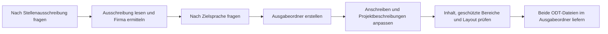

# Passgenaue Bewerbungsunterlagen für Stefan Busch erstellen

Erstelle anhand einer konkreten Stellenausschreibung und der unten genannten ODT-Vorlagen einen passgenauen Lebenslauf und ein Anschreiben. Liefere beide Dokumente als echte, in LibreOffice bearbeitbare ODT-Dateien. Führe diesen Auftrag erst aus, wenn dieser Prompt als Arbeitsauftrag verwendet wird.

## Eingaben und Sprachwahl

Frage zu Beginn einzeln nach der Stellenausschreibung:

> Bitte sende mir die vollständige Stellenausschreibung als Text oder Link.

Warte auf die Antwort. Lies bei einem Link die vollständige Ausschreibung; ist sie nicht zugänglich oder nicht mehr vollständig verfügbar, fordere den Text an. Ermittle aus der Ausschreibung mindestens Unternehmen, Stellenbezeichnung, zentrale Anforderungen und – sofern vorhanden – Ansprechperson und Standort. Sind Firmenname oder Stellenbezeichnung nicht eindeutig, frage einzeln nach.

Frage erst danach und ebenfalls einzeln nach der Ausgabesprache:

> Welche Ausgabesprache möchtest du für Anschreiben und CV?
> 1. Englisch (Standard)
> 2. Deutsch
> 3. Dänisch
> Antworte mit 1, 2 oder 3. Eine leere Antwort oder „Standard“ bedeutet Englisch.

Warte auf die Antwort. Verwende die gewählte Zielsprache für beide Dokumente, soweit die nachfolgenden Regeln unveränderte CV-Bereiche schützen. Übersetze natürlich und fachlich präzise; behalte Eigennamen, Produktnamen und etablierte technische Bezeichner bei.

Die Vorlagen liegen hier:

- Anschreiben: `/home/sb/Dokumente/sbs/bewerbungen/2025-08_bewerbung_saab/2025-08-22_cl_stefan_busch.odt`
- CV: `/home/sb/Dokumente/sbs/bewerbungen/2025-08_bewerbung_saab/2025-08-21_cv_stefan_busch.odt`

Verwende vorhandene, vom Nutzer bereitgestellte Profilunterlagen ergänzend als Faktenquelle. Unterscheide belegte Erfahrung von Anforderungen der Stellenausschreibung. Erfinde keine Kenntnisse, Tätigkeiten, Verantwortlichkeiten, Erfolge, Kennzahlen oder Qualifikationen. Stelle notwendige Rückfragen einzeln; triff bei reinen Formulierungs- und Gestaltungsentscheidungen vernünftige Annahmen.

## Ausgabedateien

Verwende das Erstellungsdatum in der Zeitzone `Europe/Berlin` im Format `yyyy-mm-dd`. Leite aus dem offiziellen Firmennamen der Stellenausschreibung einen kurzen, dateisystemtauglichen Ordnernamen ab:

- Verwende Kleinbuchstaben und Bindestriche.
- Entferne Rechtsformzusätze wie `GmbH`, `A/S`, `AG`, `ApS`, `Ltd.` oder `Inc.`, sofern sie nicht zur eindeutigen Identifikation benötigt werden.
- Wandle Umlaute in `ae`, `oe` und `ue` sowie `ß` in `ss` um.
- Entferne oder ersetze sonstige Sonderzeichen; verwende keine Schrägstriche und keine Pfadbestandteile wie `.` oder `..`.

Erstelle unter `/home/sb/Dokumente/sbs/bewerbungen` den Ausgabeordner:

`{yyyy-mm-dd}_name-der-firma-aus-der-ausschreibung`

Beispiel: Aus „Muster Technik GmbH“ wird `{yyyy-mm-dd}_muster-technik`.

Speichere darin:

- `{yyyy-mm-dd}_stefan_busch_cl.odt`
- `{yyyy-mm-dd}_stefan_busch_cv.odt`

Ersetze alle Platzhalter in den tatsächlichen Ordner- und Dateinamen. Überschreibe weder Vorlagen noch einen bereits vorhandenen Ausgabeordner oder vorhandene Ausgabedateien ohne ausdrücklichen Auftrag. Bei einer Namenskollision frage einzeln nach einem anderen Ordnernamen oder der Freigabe zum Überschreiben.

## Anschreiben erstellen

Erstelle das Anschreiben als Kopie der Anschreiben-Vorlage und passe den Inhalt an die konkrete Stelle und das Unternehmen an.

- Maximal eine Seite.
- Sachlicher, glaubwürdiger Stil ohne Angeberei, Superlative oder unbelegte Selbsteinschätzungen.
- Betone Teamarbeit und Praxisnähe anhand belegter Erfahrungen.
- Verbinde die wichtigsten Anforderungen mit konkreten passenden Erfahrungen; wiederhole nicht bloß den CV.
- Verwende eine passende Anrede und einen klaren Betreff. Verwende eine neutrale Anrede, wenn keine Ansprechperson bekannt ist.
- Aktualisiere Datum, Empfänger, Unternehmen und Stellenbezeichnung anhand gesicherter Angaben. Entferne Bezüge zur alten Bewerbung vollständig.
- Übernimm die vorhandene Formatierung, insbesondere Seitenlayout, Schriftarten, Schriftgrößen, Absatzformate und Abstände.
- Kürze den Text bei Platzproblemen. Verkleinere dafür weder Schrift noch Seitenränder.

## CV gezielt anpassen

Erstelle den CV als Kopie der CV-Vorlage. Ändere ausschließlich die fachlichen Schwerpunkte beziehungsweise Themenbeschreibungen der einzelnen Projekte innerhalb der Sektion `Professional experience`.

- Maximal zwei Seiten.
- Bewahre die zeitliche Reihenfolge sowie Zeiträume, Arbeitgeber, Kunden, Projektbezeichnungen und Rollen.
- Belasse `Language skills`, `Other`, `Education`, `Contact Details` sowie den Kopf mit den Adressdaten unverändert. Auch alle übrigen Inhalte außerhalb der Projektbeschreibungen bleiben unverändert.
- Formuliere die bearbeiteten Projektbeschreibungen in der gewählten Zielsprache.
- Falls geschützte Inhalte nicht in der Zielsprache vorliegen, frage vor der Erstellung einzeln: „Darf ich die geschützten CV-Abschnitte ausschließlich übersetzen, ohne ihre Angaben, Reihenfolge oder Formatierung zu ändern?“ Ohne ausdrückliche Freigabe bleiben diese Bereiche einschließlich ihrer Überschriften unverändert. Weise im Ergebnis auf die dadurch verbleibende gemischte Sprache hin.
- Priorisiere je Projekt die für die Stelle relevanten, belegten Themen. Betone dort, wo nachgewiesen: Teamarbeit, Mitarbeiterschulung und Wissenstransfer, Architekturkonzepte, Domain-Driven Design (DDD), CI/CD-Pipelines und Qualitätsmanagement.
- Erzwinge diese Themen nicht in jedem Projekt und stelle bloße Mitarbeit nicht als Leitungsverantwortung dar.
- Verwende konkrete, kompakte Aussagen. Übernimm Begriffe aus der Stellenausschreibung nur, wenn sie zur tatsächlich belegten Erfahrung passen.
- Bewahre die vorhandene Formatierung, insbesondere Seitenlayout, Schriftarten, Schriftgrößen, Absatzformate, Listen, Tabellen und Abstände.
- Kürze bei Platzproblemen ausschließlich die bearbeitbaren Projektbeschreibungen. Verändere keine geschützten Inhalte, Schriftgrößen oder Seitenränder, um die Seitenzahl zu erreichen.

## Dokumente prüfen und liefern

Der Ablauf führt von der Ausschreibung und Sprachwahl über die Vorlagenkopien zu geprüften ODT-Dateien:

Prüfe vor der Lieferung:

1. Alle Aussagen sind durch die Vorlagen oder ergänzende Nutzerunterlagen belegt; beide Dokumente passen zur konkreten Stellenausschreibung.
2. Namen, Kontaktdaten, Unternehmen, Stellenbezeichnung und Datum sind korrekt. Das Anschreiben enthält keine Bezüge zur alten Bewerbung und keine offenen Platzhalter.
3. Die geschützten CV-Inhalte stimmen mit der Vorlage überein; ausdrücklich freigegebene reine Übersetzungen sind die einzige Ausnahme.
4. Beide Dateien sind gültige ODT-Dokumente und lassen sich öffnen. Eine umbenannte Text-, Markdown- oder DOCX-Datei genügt nicht.
5. Rendere beide Dokumente mit einem verfügbaren Office-Werkzeug und kontrolliere alle Seiten visuell: Anschreiben höchstens eine Seite, CV höchstens zwei Seiten, keine abgeschnittenen Texte, ungewollten Leerseiten oder störenden Umbrüche. Temporäre PDF-Dateien dürfen für diese Prüfung verwendet werden.
6. Vergleiche die Gestaltung mit den Vorlagen und korrigiere Abweichungen innerhalb des erlaubten Änderungsumfangs.

Ist die Seitenbegrenzung innerhalb dieser Vorgaben nicht erreichbar, frage einzeln nach einer Entscheidung. Falls eine Öffnungs-, Render- oder Layoutprüfung technisch nicht möglich ist, benenne die konkrete Prüfungslücke und behaupte nicht, das Layout oder die Seitenzahl seien bestätigt.

Führe den gesamten Ablauf nach Beantwortung der Fragen selbstständig aus und speichere beide Dateien im neu erstellten Ausgabeordner. Liefere zum Abschluss einen klickbaren Link zum Ausgabeordner und zu beiden ODT-Dateien sowie eine kurze deutsche Zusammenfassung: Zielsprache, wichtigste inhaltliche Anpassungen, tatsächlich geprüfte Seitenzahlen und gegebenenfalls offene Punkte. Versende oder veröffentliche die Bewerbung nicht selbstständig.
